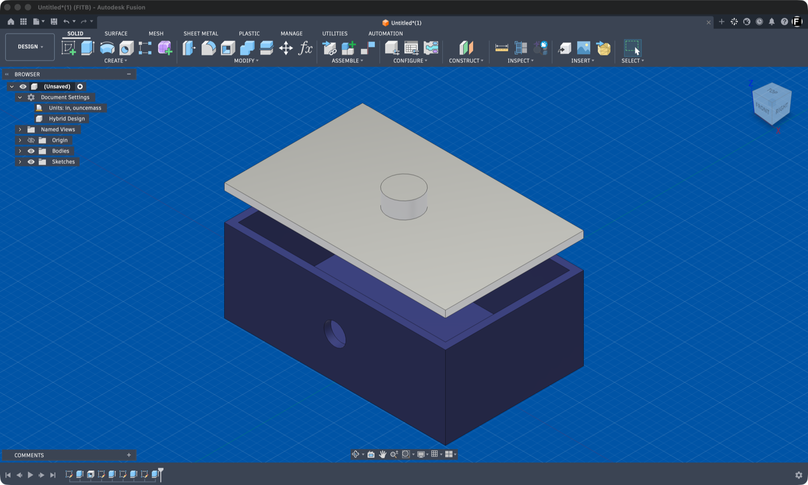
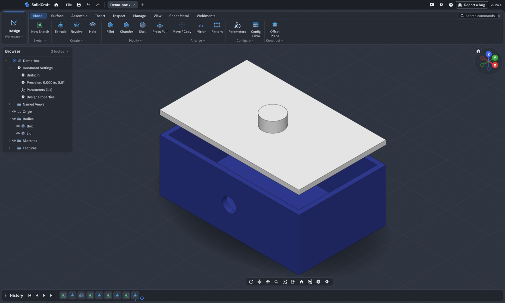
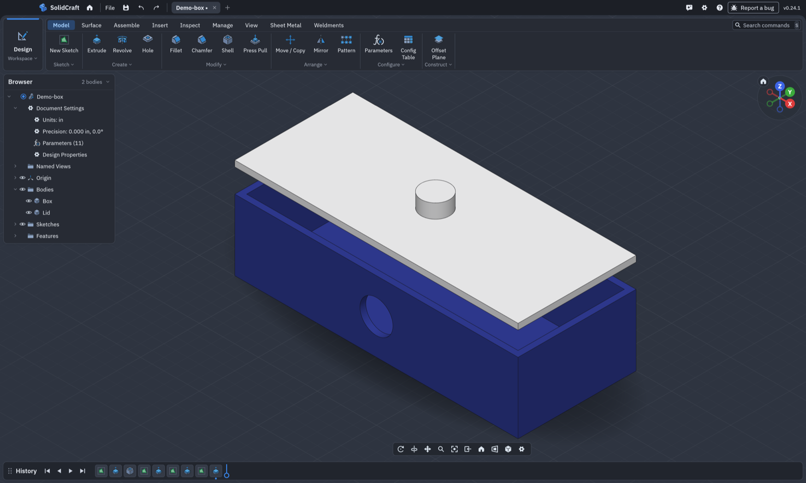

# Export to SolidCraft

A Fusion add-in that exports the open design to [SolidCraft](https://github.com/tangency-labs/solidcraft)
**with its history**. The export keeps parameters, sketches (with constraints and dimensions) and
features as an editable timeline, along with components, appearances and materials.

One click in Fusion. You don't need to save `.f3d` files first.

| In Fusion | Exported to SolidCraft |
|---|---|
|  |  |

The history stays live. Here `width` is changed from 80 mm to 120 mm and `hole_d` from 8 mm
to 14 mm in SolidCraft, and the sketches, extrudes, shell and cut all rebuild:



The demo design and its report are in [`examples/`](examples/). Its 9 steps became 53 SolidCraft
commands, with 0 failed, and every body matches Fusion.

## How it works

The add-in reads the design through Fusion's own API, step by step down the timeline, and
rebuilds each step in SolidCraft. After every step it checks each body against Fusion: volume
and centre of mass must match. When a step can't be mapped, or doesn't match, that step comes in
as Fusion's result (geometry only) and the rest keeps its history. Every export writes a report
saying exactly which steps did that.

More detail: [docs/how-it-works.md](docs/how-it-works.md).

## Install

1. Install SolidCraft. The add-in needs `solidcraft-cli`, which comes with the app, and finds it
   on its own. If it can't, it asks once.
2. Download this repository (Code → Download ZIP) and unzip it.
3. In Fusion, press **Shift+S** and open the **Add-Ins** tab. Click **+** and pick the
   `ExportToSolidCraft` folder. Select it, click **Run**, and tick **Run on Startup** if you want
   it every time.

## Use

1. Open a design. It must be parametric, with a timeline.
2. Click **Utilities → Export to SolidCraft** and choose where to save.
3. When the export finishes, it can open the result in SolidCraft. A `<name>.report.txt` is saved
   beside the design.

Linked designs are exported as their own `.solidcraft` files and linked the same way.
Fusion's window is busy while the export runs. Large designs take a few minutes.

## What carries over

- Parameters, with their expressions
- Design units
- Sketches on their exact planes: lines, arcs and circles, with constraints and driving
  dimensions. Projected geometry is kept fixed. Splines become short lines for now.
- Extrude: distance, two sides, symmetric, taper, start offset and through all; new, join, cut
  and intersect
- Combine, shell, offset faces, copy/paste and cut/paste of bodies, move, scale, remove, split
  body, and rectangular pattern of bodies
- Components, including components placed more than once
- Hidden bodies and components
- Appearances, as colour with metal or glass hints (textures don't carry over), and physical
  materials with their density

**Not mapped yet** (these come in as Fusion's result): fillet, chamfer, revolve, loft, hole,
mirror, circular pattern, patterns of features, sweeps along closed paths, sheet metal and
joints.

## Results

- 65-step furniture design: all 65 steps keep their history, and every body matches Fusion at
  every step.
- 311-step assembly with 85 components and a linked design: about 300 steps keep their history.
  The rest are a sweep and nine splits that SolidCraft can't reproduce yet. All final bodies
  match Fusion.

## Command line (development)

The scripts in `dev/` drive the same code from a terminal. They need a local bridge add-in in
Fusion that runs Python sent to `127.0.0.1:7654/execute`, with a token read from
`~/.fusion-mcp-secret`. That bridge isn't included here.

```sh
dev/fx_extract.sh "My design" my-design.json      # read the open design's timeline
python3 ExportToSolidCraft/build.py my-design.json out/my-design.solidcraft --fusion
```

`--fusion` lets a step that doesn't match fall back to Fusion's result. `--cli PATH` picks the
`solidcraft-cli` to use; `SOLIDCRAFT_CLI` works too.

## Notes

This project is independent. It is not affiliated with Autodesk or with the SolidCraft
project. It uses only Fusion's public API and SolidCraft's public command interface.

MIT licence.
